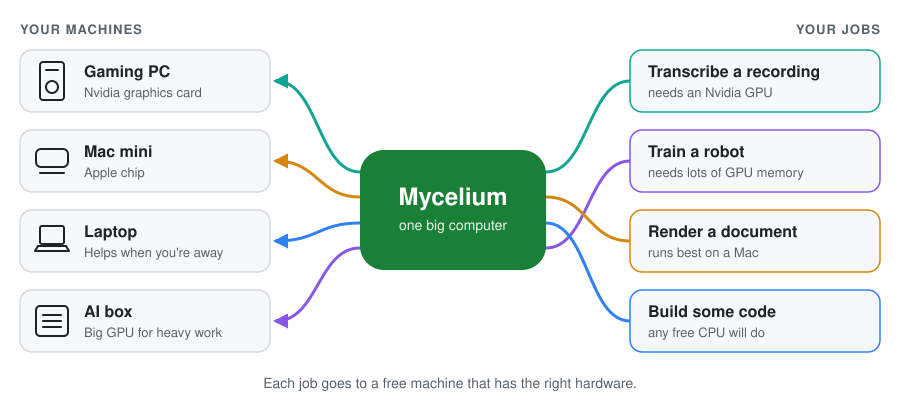

# Mycelium

**Turn the computers you already own into one big computer.**

<picture>
  <source media="(prefers-color-scheme: dark)" srcset="docs/assets/how-it-works-dark.svg">
  
</picture>

Mycelium links your computers together. You hand it a job, and it runs that job
on whichever machine is free and has the right hardware. You never have to pick
a machine yourself.

Like the fungus it's named after, it's one network with many branches, and each
of your computers is a branch.

## What it's for

- **Run any command or script** on whichever machine is free and has the
  hardware it needs.
- **Put idle computers to work** instead of leaving their power unused.
- **Share files between machines** through your network drive, without copying
  them by hand.
- **Keep the computers you use responsive.** Mark a machine as in daily use,
  and it only takes work while you're away.
- **Grow easily.** Your agent adds each new machine with one command.
- **Use what you have:** Nvidia, Intel or Apple GPUs, or just a CPU, on Linux
  and Apple Silicon Macs.

For example: ML training, simulations, rendering, data processing or builds.

Coming next: Windows, and splitting one huge job across several GPUs.

## Set it up with your AI agent

Open Claude Code, Codex or another coding agent on the computer that should be
the hub (one that stays on), and paste this:

```text
Set up Mycelium on my computers. Clone https://github.com/1kuna/mycelium,
then read docs/agent-setup.md and follow it step by step. Ask me which
computer is the hub, which others to add, and where my shared network drive
is mounted on each. Show me every install plan before running it, and never
print or commit the secret token.
```

The agent installs the hub, adds your other machines, checks that each one shows
up, and runs a test job. Before you start, you need:

- Linux or Apple Silicon Mac computers on the same local network
- A shared network drive (NAS) mounted on each one
- Working GPU drivers, if a machine has a GPU

## Try it without any setup

On one laptop with [Go](https://go.dev/dl/) installed, from a clone of this repo,
start a pretend cluster with fake GPUs. The jobs really run.

```sh
go build -o myce ./cmd/myce && ./myce dev
# in a second terminal:
MYCE_QUEUE=http://127.0.0.1:7331 MYCE_TOKEN=dev-token ./myce run -- echo hello
```

## More

[Guides](docs/START-HERE.md) · [Agent setup](docs/agent-setup.md) ·
[Laptop walkthrough](docs/try-it-locally.md) · [Running jobs](docs/job-reference.md) ·
[Operations](docs/operations.md) · [Design](docs/design-proposal.md)
