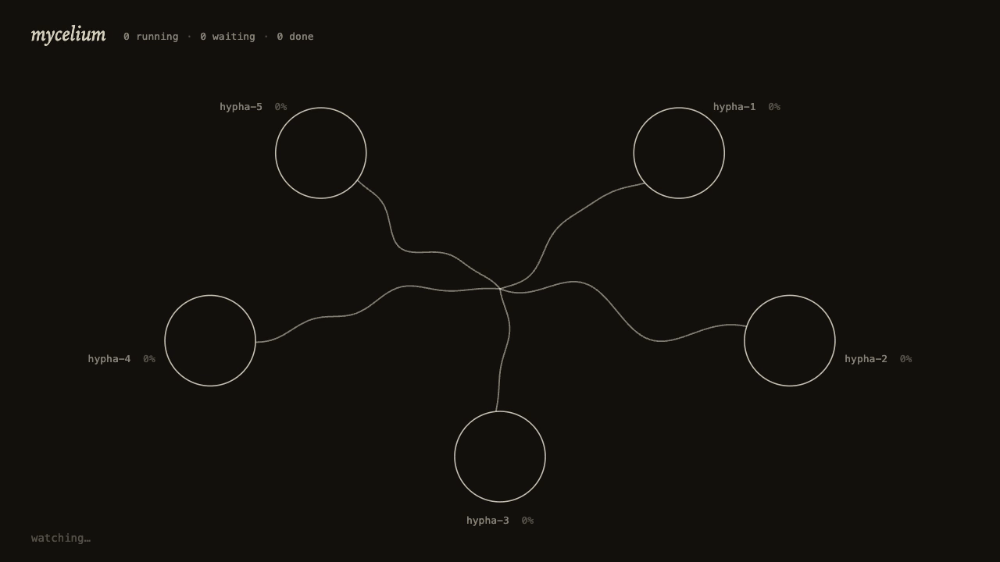
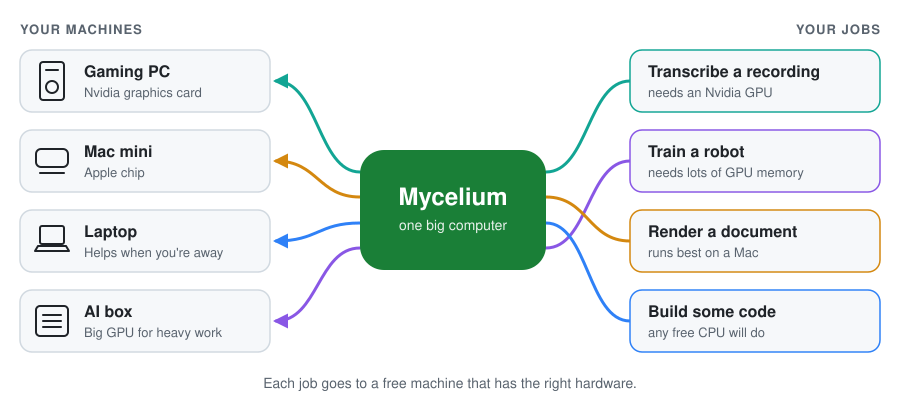

# Mycelium

**Turn the computers you already own into one big computer.** Hand Mycelium a
job and it runs on whichever of your machines is free and has the right hardware.



## Quick start

Try it on one laptop with Git and [Go](https://go.dev/dl/) 1.25.6+ on macOS or
Linux. No GPU needed: the GPUs are pretend, but the jobs really run.

```sh
git clone https://github.com/1kuna/mycelium.git
cd mycelium
go build -o myce ./cmd/myce
./myce dev -- sh examples/quickstart.sh
cat quickstart-result/result.txt
```

You should see this (job IDs, state changes and timestamps vary):

```text
Mycelium dev: temporary local queue · 2 fake workers · stops when the command exits
hello from CPU
Submitted fake-GPU job <job-id>
<job-id> succeeded
Verified quickstart-result/result.txt
hello from Mycelium
```

The demo also explains its safety limits: plain commands can access the worker
account's files, and on macOS memory protection samples usage rather than enforcing
a kernel limit. Run only trusted code here. For sandboxing or enforced Linux memory
limits, follow [isolation limits](docs/native-isolation.md). A brief wait for worker
information is normal at startup; if it persists, run `./myce status` while the queue
is running and check that a worker is connected.

The script started a temporary queue with two pretend machines, ran a CPU job,
ran a "GPU" job, downloaded its output and checked the bytes, then shut
everything down. The last line is the downloaded result.

## What it's for

- **Run any command or script** on a free machine with the hardware it needs,
  without picking the machine yourself.
- **Put idle computers to work:** builds, tests, simulations, rendering, data
  processing, model runs and training.
- **Keep the computers you use responsive.** Mark a machine as in daily use and
  it only takes work while you're away.
- **Pick up where a job left off.** Jobs that save checkpoints can stop and
  resume, even on another machine.
- **Use what you have:** Nvidia, Intel or Apple GPUs, or just CPUs, on Linux
  and Apple Silicon Macs.

## How it works

<picture>
  <source media="(prefers-color-scheme: dark)" srcset="docs/assets/how-it-works-dark.svg">
  
</picture>

One machine that stays on runs the queue: one Go binary and one SQLite file.
Every other machine runs a worker that reports its CPU, memory and GPUs and
pulls the most important job it can run. Jobs say what they need, not where to
run. If the queue restarts, queued and running batch jobs survive and workers
reconnect; in-flight model calls fail and are retried by the caller. There's no peer network or cluster database to manage.

Every feature has to work on a laptop with no GPU. `myce dev`, used in the
quick start, runs the real queue and command runner with pretend GPUs, and the
test suite uses it the same way.

## Watch it live

`myce view` serves a read-only live picture of your cluster and prints a local
address to open in your browser. It's the picture in the GIF above ([MP4](docs/media/fleet-view.mp4)). To see it with the
pretend cluster:

```sh
./myce dev --workers 5
# second terminal:
./myce view --queue http://127.0.0.1:7331 --token dev-token --anonymize
# third terminal, for a varied stream of demo jobs:
examples/fleet-view-demo.sh
```

On a real cluster, `myce view` uses your installed config, and `--anonymize`
hides machine, project and job names for recordings. See
[Live view](docs/status.md#live-view-myce-view).

## Set it up on your computers

Mycelium is built to be installed by your coding agent. Open Claude Code, Codex
or another coding agent on the computer that should be the hub (one that stays
on), and paste this:

```text
Set up Mycelium on my computers. Clone https://github.com/1kuna/mycelium,
then read docs/operations.md and follow its setup steps. Ask me which
computer is the hub, which others to add, and where my shared network drive
is mounted on each. Show me every install plan before running it, and never
print or commit the secret token.
```

The agent installs the hub, adds each machine with one command, checks that
each one shows up, and runs a test job. You need Linux or Apple Silicon Mac
computers on one local network, a shared network drive (NAS) mounted on each
for this automated route, and working GPU drivers where there's a GPU.

## How ready it is

**Solid, running real work every day:** the queue and scheduler, CPU and GPU
batch jobs, checkpoint and resume, file transfer with or without a NAS, fair
sharing between projects, and `myce dev`. Model calls and servers, software
environments and optional Docker commands are also supported.

**Experimental:** learned placement (Mycelium measuring jobs and machines to
place work better) is young and changing fast. Sandboxing is opt-in for plain
commands and has documented gaps; read [isolation limits](docs/native-isolation.md) before running code you
don't trust. `myce view` is new.

**Not yet:** Windows, and splitting one job across several machines.

## Learn more

- [Start here](docs/START-HERE.md): submit work and follow a job
- [Reusable project work](docs/adapter.md): one instruction file per project
- [Jobs](docs/jobs.md) and [files and checkpoints](docs/files.md)
- [Operations](docs/operations.md): install, add machines, upgrade, recover
- [Design](docs/design-proposal.md) and [decisions](docs/DECISIONS.md)
- [Agent skill](skills/mycelium/SKILL.md): how a project's agents use Mycelium

[`examples/`](examples) has callers and scenarios, [`extensions/`](extensions)
has starter integrations, and [`env/`](env) has environment recipes.
